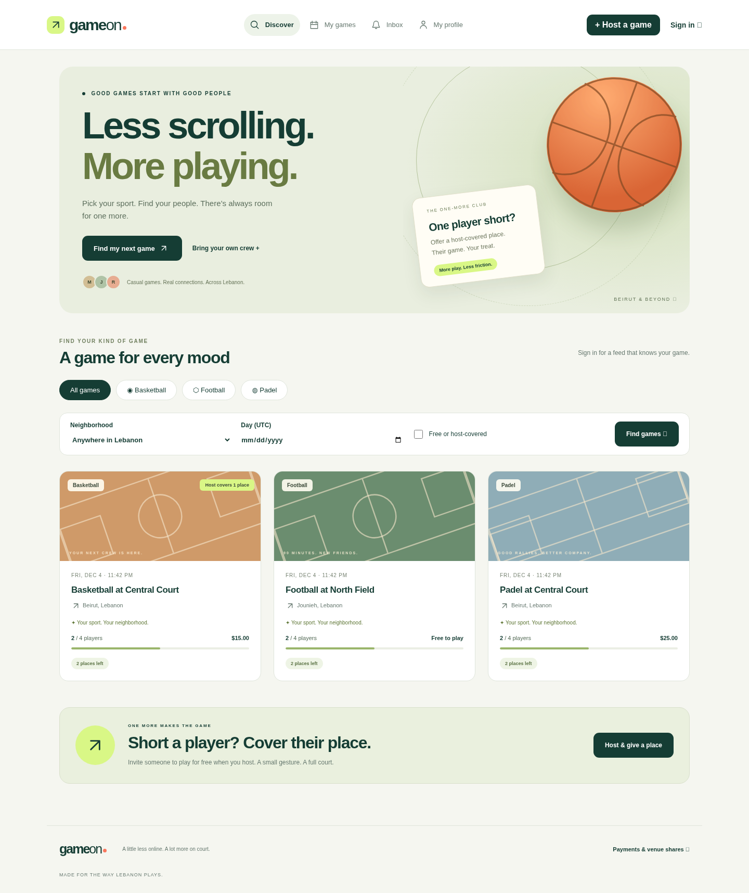

# GameOn

**Already running the first version? Follow [the upgrade guide](docs/UPGRADE.md). Run 07-platform-upgrade.sql once after backing up; do not rerun the original schema.**



*Design preview uses synthetic UI test fixtures.*

A university lab implementation using SQL Server 2022, T-SQL, ASP.NET Core 8 + ADO.NET, and React 19. No ORM is used.

## 1. Create the database and schema

A DBA creates an empty `GameOn` database using SQL Server or Azure SQL. Run these scripts in order in that database (SSMS or `sqlcmd -b -d GameOn -i <file>`; use integrated authentication or securely injected SQLCMDPASSWORD):

1. [01-schema.sql](database/01-schema.sql): complete normalized schema, keys, constraints, indexes, summary view and waitlist function.
2. [02-procedures.sql](database/02-procedures.sql): transactional join/cancel/promotion, creation, discovery, roster, account and history operations.
3. [03-seed.sql](database/03-seed.sql): development fixtures and **200,000 activity events**, generated without per-row loops. The fixture host cannot sign in; register your own account.
4. Provision a dedicated `gameon_api` server login securely outside source control, then run [04-security.sql](database/04-security.sql). Use a distinct migration identity. Do not grant the API identity admin or direct table permissions.
5. Install [07-platform-upgrade.sql](database/07-platform-upgrade.sql) in SQLCMD Mode as described in the upgrade guide.
6. Run [05-tests.sql](database/05-tests.sql), then follow the two-session concurrency lab in [architecture.md](docs/architecture.md).
7. Run [08-platform-tests.sql](database/08-platform-tests.sql) on a disposable upgraded database.
8. Run [06-performance.sql](database/06-performance.sql) with actual execution plans enabled for the large-table lab.

SQL scripts use `GO`, which is handled by SSMS/sqlcmd, not by SqlCommand. They target a fresh database; schema/security migrations are deliberately not destructive rerunnable scripts. The data seed is rerunnable. No database is created automatically by the application.

## 2. Configure and start the API

Install .NET SDK 8. Set `ConnectionStrings__GameOn` through your development secret store or environment settings. Its connection string must specify your server, database, dedicated login/authentication, `Encrypt=True;TrustServerCertificate=False`, and valid certificate trust. Do not paste credentials into source files or shell history. User-secrets is supported with id `GameOn-Local-Development`. Production requires a secret manager and secure, durable Data Protection key storage.

```sh
cd backend
dotnet restore
dotnet build --no-restore
dotnet dev-certs https --trust
dotnet run --no-build --urls https://localhost:7043
```

On Linux, install/trust the development certificate according to your distribution and .NET instructions. Node's Vite proxy must trust the signing certificate too: export the public dev certificate to a local ignored `.pem` and set `NODE_EXTRA_CA_CERTS` to that public certificate path when running Vite. Keep certificate validation enabled. Production uses a trusted HTTPS reverse proxy and same-origin `/api` forwarding. Do not expose Vite as a production server.

## 3. Start React

Node.js 22+ is recommended; Node 24 was used for the build.

```sh
cd frontend
npm ci
npm run dev
```

Vite forwards `/api` to `https://localhost:7043`. Both UI and API use one browser origin through this proxy; no permissive CORS is required. `npm run build` creates `frontend/dist` for deployment behind the same HTTPS origin as the API. The redesigned UI includes personalized discovery, editable profiles/preferences, game details/maps/rosters, host editing and cancellation, My Games, host-covered places, and a persisted notification inbox. See the upgrade guide for optional Maps Embed and password-recovery email activation. Online collection and cash-out await the merchant provider integration. Dates are stored in UTC; discovery's date filter is explicitly UTC, while game start displays and input use browser local time.

## 4. Functional validation

Register two or more accounts in separate browser profiles. Create a game with capacity 2 (the host is automatically enrolled). A second account joins; a third is queued. Leave with the second account; refresh the third account's My Games and verify Joined. Verify duplicate Join does not increment the count, an unauthenticated Join returns 401, invalid capacity fails, and a missing/invalid CSRF token rejects a state change. Check SQL results and audit events, not just HTTP status. API lookup reads and registration require database migrations and least-privilege grants first.

See [architecture and performance guide](docs/architecture.md) for transaction reasoning, execution-plan interpretation, security boundaries, and known scope limits. See [validation record](docs/validation.md) for checks actually run in this environment.
