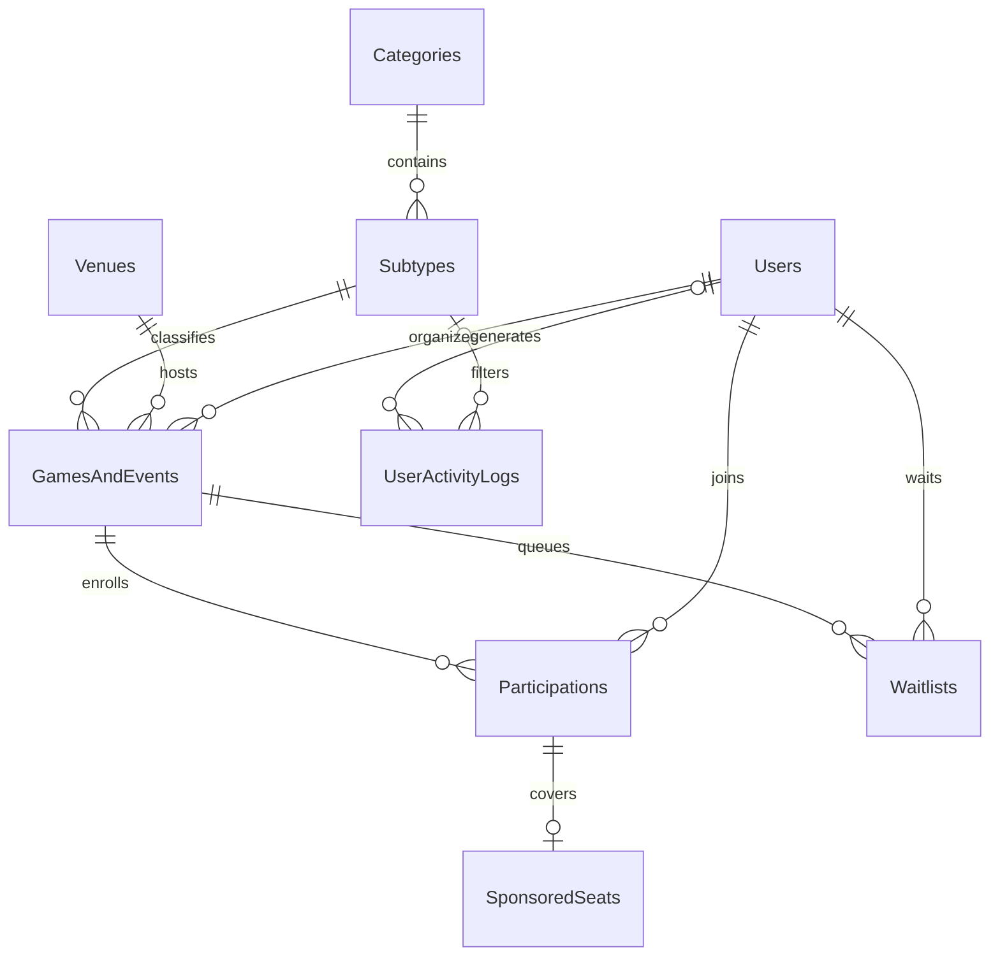

# GIN401 — Sports and Entertainment Activities

## Installation and existing data

Existing original installations run 07-platform-upgrade.sql first, then 09-categories-and-events.sql. If version 7 is already installed, run only version 9. Back up first and use SSMS Query > SQLCMD Mode or sqlcmd -b. Version guards refuse duplicate installation. Both migrations use a transaction across batches and SQLCMD stops on error; do not remove :ON ERROR EXIT or execute selected portions.

Fresh lab databases can use database/install-fresh.sql, executed from the repository root with sqlcmd and a separately privileged migration identity. Securely provision the dedicated gameon_api login first. The installer refuses to replace an existing GameOn database. It includes the two 200k development seeds. Never put credentials into this script.

## Final schema

Actual normalized storage tables include:

- Categories: Sports and Entertainment Activities, with stable slugs.
- Subtypes: nine sports and eight activities, each referencing exactly one category.
- GamesAndEvents: event identity, subtype FK, host FK, venue FK, UTC start, capacity, price and lifecycle.
- Users: identity, salted password hash, profile and session security version.
- Venues: name, area and address.
- Participations: unique (GameId, UserId), join time and payment preference.
- Waitlists: unique (GameId, UserId), monotonically allocated FIFO identity and payment preference.
- SponsoredSeats: host-covered places tied to an actual participation.
- UserActivityLogs: append-only search/view/interaction facts, nullable user for guests, subtype/event references, UTC occurrence and an explicit synthetic flag.
- Existing GameActivityLogs, notifications, preferences and password-recovery tables remain in use.

To preserve existing ids, data and frontend URLs, version 9 renames the physical Sports table to Subtypes and Games to GamesAndEvents. It renames their key columns to SubtypeId and EventId. SQL Server retains FK references by object/column identity. Single-table updateable views named Sports and Games expose the old names to existing procedures. There are no duplicate catalogs or synchronized event tables. API aliases sportId/gameId remain for backwards compatibility; lookups also expose subtypeId/category metadata. No SQL security principal gains direct view or table access.

Categories are derived through the subtype FK rather than copied into each event, avoiding category/subtype disagreement. Player counts are derived from confirmed participations. Foreign keys restrict destructive deletion of historical references. The only membership cascade is sponsored-place removal when its participation is deleted.

## Complete required catalog

Sports: Football (Soccer), Basketball, Padel, Tennis, Volleyball, Badminton, Table Tennis (Ping Pong), Squash, Swimming.

Activities: Paintball, Laser Tag, iCombat / Tactical Laser Tag, Escape Rooms, Go-Karting, Bowling, Archery Tag, Airsoft.

The migration preserves the original Basketball, Football and Padel ids; it updates the Football display name. Stable subtype slugs are used for seeds/tests. Existing custom catalog entries remain preserved.

## Race-safe enrollment

The API calls dbo.sp_JoinGameOrActivity using explicit typed SqlParameters. It sets READ COMMITTED, begins an explicit transaction, and locks the actual GamesAndEvents row using UPDLOCK,HOLDLOCK. The count check, participation/waitlist insert, optional sponsorship and notifications commit together. All other membership writers take the same underlying row lock, including procedures accessing the legacy Games view.

Two independent users cannot both consume the last place: the loser waits for the row lock, then sees the winner's committed participation and joins the FIFO waitlist. Repeated requests are idempotent. Sponsor claims are also serialized. Cancellation deletes membership and promotes the first queue entry, including its payment preference, atomically. Capacity increases promote queued participants in a set-based operation under the same lock. TRY/CATCH rolls back and rethrows failures.

The sp_ prefix is retained to meet the lab's requested procedure name. Stored procedure names and SQL text are fixed code, not user input. Database.Call explicitly calls command.Parameters.Add for every SqlParameter, with SqlDbType, lengths and decimal precision/scale. No query concatenates a filter value, email, id or payment amount into SQL.

## Large analytics table

10-user-analytics-seed.sql generates 200,000 explicitly synthetic rows using a set-based tally CTE. Rows span 256 disabled fixture accounts, all catalog types, four Lebanese areas, five action types and 180 days. No real user's history is fabricated. Rerunning tops up to 200,000 synthetic rows instead of doubling them. Generation time depends on hardware, transaction log throughput and index maintenance; no instant-runtime claim is made.

Real discovery and detail reads append minimal analytics through stored procedures. No passwords, tokens, email addresses, payment credentials or raw IP addresses are stored in the analytics table. Production needs a declared retention policy and separately privileged maintenance job.

11-analytics-performance.sql provides user timeline, subtype timeline and daily aggregation queries with STATISTICS IO/TIME. Leading equality keys followed by OccurredAt/LogId support narrow covered timelines. The time-first index supports time-bounded aggregates. Keep range predicates on the stored timestamp; grouping by date is allowed after filtering. Inspect actual versus estimated rows, logical reads, sorts, spills and key lookups. A broad aggregation may legitimately scan a bounded range. Measure representative workload plans rather than asserting every query must seek.

## Reproducible validation

From the repository root, `dotnet run --project tests/GameOn.DatabaseChecks -- --syntax` parses all SQL files using Microsoft ScriptDom in SQL Server 2022 mode. This needs no database and does not execute migrations or validate referenced objects.

1. On a disposable upgraded database, run 05-tests.sql, 08-platform-tests.sql and 12-category-event-tests.sql. Run seed 10 before test 12.
2. Use tests/GameOn.DatabaseChecks for true two-connection races, including a deliberately held event lock. Configure GAMEON_TEST_CONNECTION_STRING securely for an admin/migration identity targeting a disposable database whose name ends in _Tests, plus GAMEON_DISPOSABLE_TESTS=yes. Run `dotnet run --project tests/GameOn.DatabaseChecks`. Never use the production database. It creates and cleans its own fixtures.
3. Run database/11-analytics-performance.sql with SSMS Actual Execution Plan enabled.
4. Run `npm run test:ui` inside frontend while Vite is running. These browser checks use explicit API fixtures and do not prove database correctness.
5. Run scripts/security-smoke.py against the actual HTTPS API with its trusted public development certificate.

## Whish and cash

The user confirmed cash paid in person plus Whish player payments, and explicitly asked to skip/mock live execution for now. No host cash-out flow is requested in this version.

Server-side configuration records these merchant-supplied roots:

- Sandbox: https://lb.sandbox.whish.money/itel-service/api/
- Production: https://whish.money/itel-service/api/

Whish:Environment defaults to sandbox. Whish:ChannelId, Whish:SecretKey and Whish:WebsiteUrl belong in User Secrets or a server secret manager. No values are shipped. The named server HttpClient uses only those fixed HTTPS roots, but no operations or authentication headers are guessed: private endpoint paths, request signing, status verification and webhook rules are still needed before implementing real checkout.

Cash reservations persist Cash as a payment preference in both participation and waitlist rows. This is not a receipt or a statement that cash was received. Whish is visibly unavailable; even a forged positive-price join request with Whish is rejected transactionally. The app creates no fake paid reservation, wallet balance, receipt, refund or external transfer. Free/host-covered places require no online payment.

## Release limits

This is a tested source implementation and lab package, not a certified production deployment. Browser fixtures and T-SQL syntax checks are separate from executing live migrations/concurrency tests. Production needs measured load tests, verified backup/restore, deployment-specific TLS and key protection, genuine venue data, monitoring, and the actual merchant contract before enabling online payments. Existing seeded venue addresses are synthetic, not verified activity operators.

## Commercial extension

Version 13 adds Payments, PaymentWebhookEvents and SponsoredVenues, 2% decimal service fees, cash receivables and a development-only signed mock Whish flow. Follow [COMMERCIAL.md](COMMERCIAL.md). No real Paid state or money transfer is fabricated.
