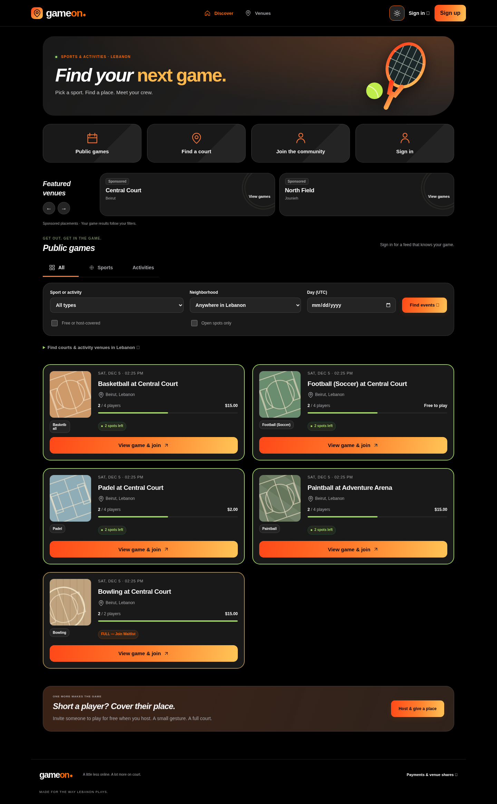
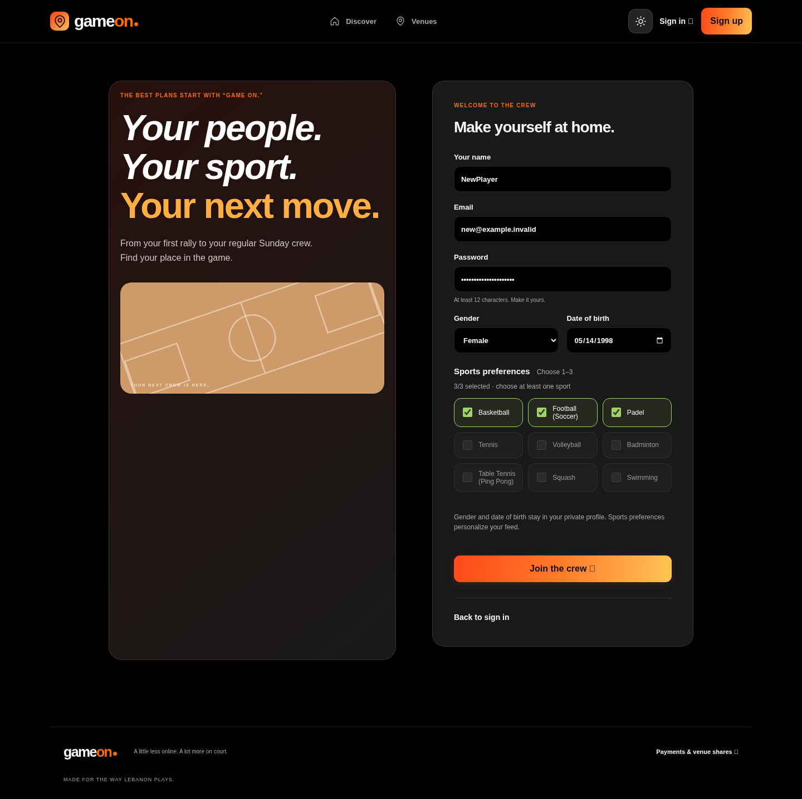
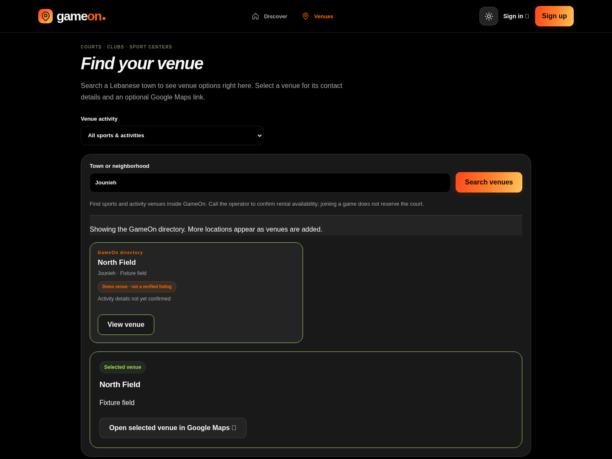

# Signup, venues and the new design

This update changes the database, backend and frontend together. It requires **migration 20 after migration 18**. The older UI-only instructions do not apply to this release.

## Update your current Windows installation

1. Stop the API in Visual Studio (red square). Stop Vite with **Ctrl+C** in its terminal. Back up your GameOn database and keep a copy of your current project folder.
2. Download and extract the [latest project ZIP](https://github.com/mariaakikiiiii/Project/archive/refs/heads/main.zip). Open the extracted `GameOn.sln`. Use the complete new project, including backend and frontend. Keep your existing database and connection-string User Secret; the project uses the same User Secrets ID.
3. In SSMS, open `database/20-onboarding-venues.sql`. Run the **whole file** once in a fresh query window, in ordinary mode (**SQLCMD Mode off**). It requires your successfully installed migration 18. Expect `Migration 20 completed successfully`. Do not rerun the original schema, the repair script or migration 18.
4. In Visual Studio, select `GameOn.Api` and the `https` profile, then press **F5**. Keep the API running.
5. Open Developer PowerShell in the new project's root folder. Run the following commands **one at a time**:

```powershell
cd frontend
```

```powershell
npm ci
```

```powershell
dotnet dev-certs https --export-path "$env:TEMP\gameon-dev.pem" --format PEM --no-password
```

```powershell
$env:NODE_EXTRA_CA_CERTS = "$env:TEMP\gameon-dev.pem"
```

```powershell
npm run dev
```

6. Open http://localhost:5173/ and press **Ctrl+F5**. Choose dark mode with the theme button to see the black/charcoal design from your reference. Your earlier light-mode preference is preserved.

If `npm ci` reports an esbuild EPERM error, another frontend process may still be running: stop its terminal with Ctrl+C before trying again. If npm cannot find package.json, make sure the terminal path ends in `frontend`.

## Try the changes

- Signed out: navigation contains Discover and Venues, plus sign-in/signup buttons. My games, Inbox, My profile and hosting appear after authentication. Direct private-page bookmarks still require sign-in.
- Sign up: enter gender, date of birth and **one to three sports**. A fourth sport is disabled until you deselect one. Both API and SQL validate the selection; registration saves the account and preferences atomically and signs the user in. DOB and gender remain private to the account. Existing accounts keep unknown demographics empty.
- Open Venues and search `Jounieh`. Matching entries appear inside GameOn. Select a venue to view its details and optional Google Maps directions link. The host form uses the same search and can select a directory venue directly.
- The design uses black backgrounds, charcoal rounded cards, orange-to-yellow buttons, green event borders and a responsive bottom navigation, based on the supplied screenshots. All shortcuts lead to supported functions.

## Real venue coverage

The built-in directory searches the venues actually stored in your database, without needing Google credentials. Original Central Court and North Field entries are clearly marked **demo venues**; they are not a verified nationwide catalog. Activity details are marked unknown when a venue has not been classified. Search results do not guarantee available courts or a completed reservation; contact the venue.

A trusted payment/venue operator can open Venues → Add a real venue to enter its actual name, area, address, phone and supported activities. Only mark contact details verified after checking them. Existing database-controlled `PaymentOperators` membership authorizes this action; signing up never grants operator permissions. Additions are audited with the operator ID and timestamp.

If your Google Maps browser key, Places API and billing are configured as described in [UPDATE-16.md](UPDATE-16.md), Google venue results also appear **inside GameOn**. Opening Google Maps remains optional after selection. Without those credentials, the local directory still works. Google coverage is provider-dependent; no claim is made that every sports center in Lebanon is listed or bookable. Custom Google pins still require server-side Lebanon verification when hosting.

## Validation

`database/21-onboarding-venue-tests.sql` provides rollback-only SQL acceptance fixtures for a disposable test database after migration 20. These were syntax-checked here, not executed against SQL Server. Browser tests use explicit API/Google fixtures, not live venue data. See [validation.md](validation.md).

## Previews

Screenshots below use synthetic browser-test fixtures.






